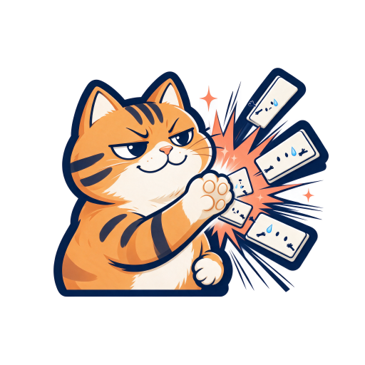
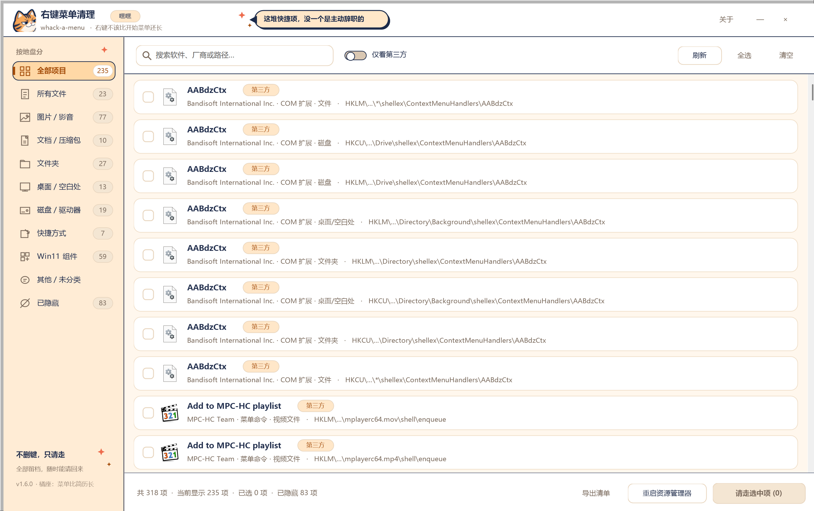
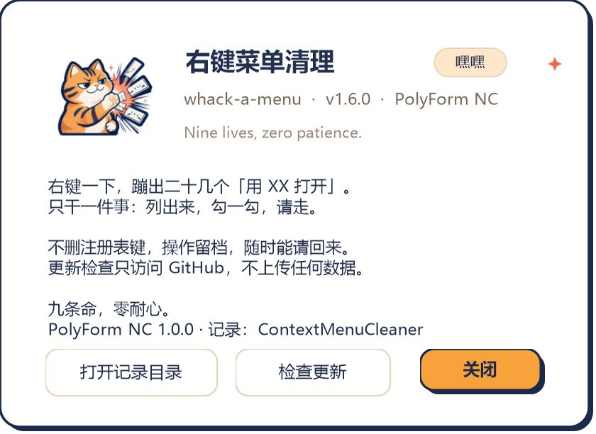

# whack-a-menu · 右键菜单清理器

[](LICENSE)
[](https://www.microsoft.com/windows/windows-11)
[](https://learn.microsoft.com/dotnet/framework/)
[](build.ps1)

> 右键一个文件，蹦出来二十几个「用 XX 打开」「上传到 XX」「XX 压缩到…」。
> 它们没做错什么，只是太吵了。

**whack-a-menu** —— 冒出来一个，拍掉一个。打地鼠的 *whack*，橘猫的爪子。

一个只干一件事的小工具：把 Win11 右键菜单里那些自己跑进来的第三方快捷项**列出来，勾一勾，请到一边去**。
不删注册表键，全部留档，随时能请回来。

> 仓库：<https://github.com/KyuuKyuuStone/whack-a-menu> · [项目介绍页](docs/index.html) · 协议：[PolyForm Noncommercial 1.0.0](LICENSE)

项目作者 [KyuuKyuuStone / 九川](https://github.com/KyuuKyuuStone/KyuuKyuuStone) 的主页写着
「石头不是卖萌，是引力比较大」。但石头长得实在不太行，于是换成了**一只斜眼坏笑的橘猫**：
一爪把右键菜单拍飞。代号「橘座」，九条命，零耐心。顺便，界面里藏了个「嘿嘿」。

- 打开即列出所有右键菜单项：**软件图标 + 名称 + 厂商 + 来源位置**
- 按 Explorer 的真实作用域分类（含图片 / 影音 / 文档 / 压缩包等文件类型），隐藏项只在「已隐藏」页出现
- 勾选式操作，支持搜索、分类、批量清理
- **可逆清理**：不删除注册表，只做隐藏；所有操作留记录，随时一键恢复
- 系统内置项自动识别并加锁，避免误伤
- **完整 DPI 自适应**：跟随 Windows 11 的 125% / 150% / 200% 显示缩放，窗口按屏幕工作区自适应，文字、图标、行高、按钮整体等比放大
- **贴纸漫画风 UI**：跟橘猫 LOGO 同一套奶白 / 猫橘 / 深蓝配色，粗描边与硬边阴影
- 单文件绿色 exe，无需安装、无需 .NET 运行时（Win11 自带 .NET Framework 4.8）
- 启动时静默检查 GitHub Releases，有新版本才提示（也可在「关于」里手动检查）
- 源码公开，[PolyForm Noncommercial 1.0.0](LICENSE) 协议：**禁止商用**

> 目标系统：**仅 Windows 11**（21H2 及以上），不再适配 Windows 10 及更早版本。
> 扫描、隐藏、恢复全部在本地完成；唯一联网行为是启动时读取 GitHub Releases 版本号，
> 不上传任何数据、不写系统目录。详见[检查更新](#检查更新)。

---

## 为什么需要它

装了解压软件、网盘、Git、播放器、杀软、编辑器之后，右键一个文件会弹出长长一串：
「用 XX 打开」「上传到 XX」「XX 压缩到…」「扫描病毒」……有的还藏在「显示更多选项」里。
手工清理要去 `regedit` 里翻 `HKCR\*\shell`、`shellex\ContextMenuHandlers`、Win11 的 `PackagedCom`，
既难找又容易删错。这个工具把这些位置全部扫出来，用一张清单呈现，勾选即可隐藏。

## 图标：一只不太正经的橘猫



前三版（UI 插画风、极简方框减号、灰色石头）都被否了。现在是**斜眼坏笑的橘猫**，抬爪一巴掌
把几条右键菜单拍飞；菜单条们长着惊恐小眼睛和汗滴，橙色爆炸星是顺手送的。
贴纸式粗描边、暖橘 + 奶白 + 深蓝、无文字无渐变 —— 沙雕，缩到任务栏里还认得出是谁。

[深色背景预览](docs/logo-dark.png) · [各尺寸对照](docs/logo-sizes.png)

细节多的吉祥物缩到 16 / 32px 必然糊成一团，所以
[tools/build_icon_from_image.py](tools/build_icon_from_image.py) 做了两件事：

- 从四边泛洪去白底（不用全局白色键，否则白色菜单条、星星会被一起抠掉）
- **响应式小图标**：64px 及以下裁成「猫耳 + 坏笑」的大头照，128 / 256px 保留完整构图。
  这版画面留白多，用 `--mask none` 保留透明边缘；满构图的旧版则用 `--mask circle`
  加圆形柔边遮罩，避免小图标变成一块方形色块

概念图由 Seedream 生成（`assets/logo-source.png`），脚本输出 16–256px 多尺寸透明 ICO；
`docs/logo-embed.png` 是 256px 版本，编译时用 `/resource:` 嵌进 exe，在「关于」里以 88px 显示。

## 界面

```
┌──────────────────────────────────────────────────────────────┐
│ ▣ 右键菜单清理   whack-a-menu    [橘座说]     关于  ─   ✕  │
├──────────────┬───────────────────────────────────────────────┤
│ ▤ 全部项目 235│  🔍 搜索软件、厂商或路径… [仅看第三方] [刷新] │
│ ▤ 所有文件  23│ ┌───────────────────────────────────────────┐ │
│ ▤ 图片/影音 77│ │ ☐ [icon] 7-Zip → 压缩包      第三方  文件  │ │
│ ▤ 文档/压缩  10│ │        Igor Pavlov · HKLM\…\shell\7-Zip     │ │
│ ▤ 文件夹    27│ ├───────────────────────────────────────────┤ │
│ ▤ 桌面/空白  13│ │ ☐ [icon] 上传到百度网盘      第三方  文件  │ │
│ ▤ 磁盘/驱动  19│ │        北京百度 · HKCU\…\shellex\…           │ │
│ ▤ 快捷方式   7│ └───────────────────────────────────────────┘ │
│ ▤ Win11 组件 59│  共 318 项 · 当前显示 235 · 已隐藏 83          │
│ ▤ 已隐藏    83│                          [请走选中项 (0)]     │
└──────────────┴───────────────────────────────────────────────┘
```

主界面与关于框（均由程序自身离屏渲染生成）：





- 每行显示：**32×32 真实图标**（从 EXE / DLL / CLSID DefaultIcon 提取）、显示名、厂商、注册表来源、作用范围
- 标签：`第三方` / `系统`（系统项默认锁住，需二次确认）、`需管理员`
- **隐藏项只出现在「已隐藏」页**：常规分类不再夹带已经请走的项，数字对得上（`全部项目 + 已隐藏 = 扫描总数`）
- 分类按 Explorer 的真实作用域：全部 / 所有文件 / 图片·影音 / 文档·压缩包 / 文件夹 / 桌面·空白处 / 磁盘·驱动器 / 快捷方式 / Win11 组件 / 其他 / 已隐藏
- 除 `*`、`AllFilesystemObjects`、`Directory`、`Drive` 等常规位置外，还会扫描
  `SystemFileAssociations\image|video|audio|…` 与常见扩展名指向的 ProgID，把「右键一张图片才会出现」的项归到图片/影音；
  ProgID 的 `open/edit/new/print` 等默认动词会被跳过，不混进清单
- 底部：导出清单（CSV）、重启资源管理器、全选 / 清空、请走 / 放回来
- 找不到结果时会显示「咻—— 一只菜单条都没有」，还有橘座摊爪补刀
- **点一下标题栏的橘座就会顶嘴**，三下「嘿嘿」，七下解锁成就；标题栏有轮换台词的「橘座说」气泡
- 刷新 / 清理 / 恢复的 Toast 走随机吐槽池，侧边栏会按扫到的菜单数量给评语
- 只有搞怪模式，没有「正经」开关；功能词保持直白，玩梗不影响操作

### 界面风格：贴纸漫画

UI 跟 LOGO 用同一套视觉语言：暖奶白纸底、猫橘主色，深蓝（取自 LOGO 的描边）负责
粗轮廓和 3px 硬边偏移阴影；主按钮是「橘底 + 深蓝字 + 深蓝描边」，按下时会陷进自己的阴影里。
四角星是 LOGO 里那几颗，散在标题栏与侧边栏。

列表卡片刻意**不加阴影**——两百多行一起晃眼——只用暖色细边、纯白底和勾选态的橘色粗边分层。
拖窗 / 拉伸时不再逐帧重建圆角裁剪、也不再重排全部行控件，松手后统一重绘一次。

### 橘座会说话（唯一模式）

标题栏那个橙色气泡里是橘座的随机台词（10 句轮换）：刷新、切换分类、点击它都会换一句。
点橘座三下给「嘿嘿，被你发现了」，七下解锁「橘座已经被你点烦了」。Toast 也是吐槽池，
侧边栏底部按菜单总数给评语（>200 项：「菜单比简历长」）。

v1.6.0 起移除了「搞怪 ON / 正经」开关与 `--serious` 参数：**只有搞怪这一档**。
按钮、提示、Toast 都用「不删键，只请走」这套说法，功能词依旧直白，不影响操作。

## 快速开始

### 下载

从 [Releases](https://github.com/KyuuKyuuStone/whack-a-menu/releases/latest) 下载
`ContextMenuCleaner.exe`（单文件，免安装，约 260 KB）。

**带截图的图文教程见[项目介绍页](docs/index.html)**：在仓库 Settings → Pages 选择
`main` / `docs` 后，也可以用 <https://kyuukyuustone.github.io/whack-a-menu/> 访问。

### 直接用

1. 下载 exe 双击运行，或克隆仓库后双击 `build.bat` 自己编译
2. 双击运行（**右键菜单里属于 HKLM 的项需要管理员权限**，建议「以管理员身份运行」一次）
3. 勾选想请走的项 → 点「请走选中项」
4. 点「重启资源管理器」让菜单立即刷新（或注销 / 重启）
5. 后悔了：切到「已隐藏」分类，勾选 → 点「放回来」

### 自己编译

需要 Windows 自带的 .NET Framework 4.x 编译器，无需 Visual Studio：

```powershell
git clone https://github.com/KyuuKyuuStone/whack-a-menu.git
cd whack-a-menu

# PowerShell
.\build.ps1

# 或者双击
build.bat
```

产物：`dist\ContextMenuCleaner.exe`（单文件，约 250 KB，含多尺寸 ICO 与嵌入的吉祥物大图）。

命令行自检（不启界面，扫描真实注册表并输出报告，适合 CI / 排查）：

```powershell
.\dist\ContextMenuCleaner.exe --selftest
# 报告写入 dist\selftest-report.txt

.\dist\ContextMenuCleaner.exe --render docs\screenshot.png
# 离屏渲染主界面到 PNG，用于文档截图 / UI 自检
# 追加 --screen 可额外保存一份真实屏幕截图 *-screen.png

.\dist\ContextMenuCleaner.exe --about docs\about.png
# 离屏渲染「关于」框，验证嵌入的吉祥物大图与排版

.\dist\ContextMenuCleaner.exe --roundtrip
# 用临时 HKCU 测试键完整跑一遍「隐藏 → 校验 → 恢复 → 清理」，验证可逆性

.\dist\ContextMenuCleaner.exe --scale 1.5 --render preview.png
# 覆盖自动 DPI 缩放，检查任意缩放比例下的界面
```

## 检查更新

程序启动后在后台读取一次
`api.github.com/repos/KyuuKyuuStone/whack-a-menu/releases/latest`，只取版本号，
**不上传任何本机数据**；6 秒超时后静默失败，绝不影响主程序。只有发现新版本才弹提示，
点「否」后该版本不再提醒（记录在 `%LOCALAPPDATA%\ContextMenuCleaner\update-dismiss.txt`）。

- 手动检查：`关于 → 检查更新`
- 命令行：`.\dist\ContextMenuCleaner.exe --check-update`
- 网络受限环境会读取 `HTTPS_PROXY` / `HTTP_PROXY` 环境变量走代理；接口不可用时不弹错误

除这一次版本查询外，扫描、隐藏、恢复、导出全部在本地完成。

## DPI 自适应

程序启动后用 `GetDpiForSystem()` 读取 Windows 11 的真实显示缩放，得到 UI 缩放因子
（下限 1.25×、上限 2×，避免 100% 屏幕上界面偏小）：

- 所有布局常量按 96 DPI **逻辑像素**书写，控件位置与尺寸经 `Theme.S()` 换算成物理像素；
- 每个自绘 `Paint` 统一做一次 `ScaleTransform`，文字、图标、圆角、边框、复选框一起等比放大；
- 字体使用 `GraphicsUnit.Pixel` 固定尺寸（GDI+ 内存位图会虚报 192 DPI，用「点」单位会把字放大一倍），
  原生 TextBox 单独按物理尺寸设置字体；
- 列表图标以 64px 源图渲染，缩到 32 逻辑像素后在高 DPI 下依然锐利；
- 窗口初始大小取 `min(1400×880 × 缩放, 屏幕工作区 92%)`，右下角仍可拖拽调整。

在 200% 缩放的 4K 屏上，窗口、字号、行高都是原来的两倍，不会再出现「窗口和字都特别小」的情况。

## 清理原理（重要：可逆，不是删除）

| 菜单项类型 | 注册表位置 | 处理方式 | 恢复方式 |
| --- | --- | --- | --- |
| 静态命令（shell verb） | `*\shell\<名称>`、`Directory\shell\…` 等 | 写入 `ProgrammaticAccessOnly`；若带 `ExplorerCommandHandler`（Win11 现代菜单）则把 CLSID 备份后移除 | 删除该值、写回 CLSID |
| COM 扩展 | `*\shellex\ContextMenuHandlers\<名称>`、`Directory\Background\shellex\…` | 把默认值（CLSID）备份到 `CMC_OriginalCLSID`，默认值置空，Explorer 便不再加载 | 写回原 CLSID |
| Win11 打包应用扩展 | `Classes\PackagedCom\Package\…\Class\<CLSID>` | 把 CLSID 加入 `…\Shell Extensions\Blocked`（系统官方黑名单机制，需管理员） | 从黑名单移除 |

- 每个操作都会在 `%LOCALAPPDATA%\ContextMenuCleaner\hidden.xml` 留一条记录（原路径、原值、时间），
  所以「已隐藏」列表永不丢失，即使程序被移动、重装也能恢复。
- `CMC_` 前缀是我们自己加的备份值，不会与其他软件冲突；卸载本工具时按「恢复全部」即可干净退场。
- 菜单缓存由 Explorer 持有，改完建议点「重启资源管理器」；此操作只会让任务栏闪一下，不会关闭你的程序。
- 更完整的注册表说明见 [docs/REGISTRY.md](docs/REGISTRY.md)。

## 安全设计

- **不删除任何注册表键**，不使用 `reg delete`，不碰系统文件
- 系统项（路径位于 `%windir%`、微软签名组件、常见内置 verb）自动标记并锁定，勾选需二次确认
- HKLM 项在非管理员下会显示「需管理员」并拒绝写入，不会半途改坏
- 所有写操作逐条 try/catch，失败项会明确列出，不会静默吞掉；批量操作中单项异常不会中断整批
- 隐藏记录写入失败会明确告警（注册表里的 `CMC_*` 备份值仍可人工恢复），不会抛异常崩溃
- 静态命令同时备份 `ExplorerCommandHandler` 与 `DelegateExecute` 两类现代菜单入口，避免「清了但菜单还在」
- Win11 打包组件恢复时一定会删除系统黑名单值；软件已卸载的孤立记录无需管理员即可清除
- 单实例运行，避免并发写注册表
- 导出清单、双击查看、全选等操作都有异常保护；双击查看详情不会误改勾选状态

## 已知边界

- 少数软件把菜单项写死在自己的 COM 组件里、每次启动自检重写注册表，清理后可能被重新写入（再清一次即可，或在该软件设置里关掉「集成资源管理器」）。
- Windows 11 原生「新建」「打开方式」「共享」等属于系统组件，工具会锁定，不建议隐藏。
- 本工具只处理**文件 / 文件夹 / 空白处 / 磁盘**的右键菜单，不处理任务栏、开始菜单右键。

## 目录结构

```
├── LICENSE                 PolyForm Noncommercial 1.0.0（禁止商用）
├── README.md
├── build.ps1 / build.bat   一键编译（系统自带 csc）
├── docs/REGISTRY.md        注册表原理与排查手册
├── docs/index.html         项目介绍页（GitHub Pages：Settings → Pages 选 main / docs）
├── docs/logo.png           透明应用图标（512px）
├── docs/logo-dark.png      深色背景下的图标预览
├── docs/logo-sizes.png     128 / 64 / 32 / 16px 浅色与深色对照
├── docs/logo-embed.png     256px 透明图，编译时嵌入 exe
├── docs/screenshot.png     界面预览（由 --render 生成）
├── docs/about.png          「关于」框预览（由 --about 生成）
├── assets/logo-source.png  Seedream 生成的图标原图
├── tools/build_icon_from_image.py  PNG 抠白底 → 响应式多尺寸 ICO
├── tools/make_icon.py      纯代码绘制 ICO（无外部素材时的备选）
├── src/
│   ├── Program.cs          入口、单实例、自检模式
│   ├── app.manifest        DPI 感知 / 权限声明
│   ├── AppIcon.ico
│   ├── Models/             数据模型
│   ├── Core/               扫描、图标解析、隐藏恢复、本地记录、Win32 API
│   └── UI/                 自绘窗体与控件
└── dist/                   编译产物
```

## 参与

欢迎提 Issue / PR。代码是纯 C# + Win32 API，无第三方依赖，注释里写清了每处注册表操作的理由。
如果你发现某个软件的右键项没被扫出来，请附上 `regedit` 里对应的键路径，我们会补进扫描规则。

## 免责声明

工具按 PolyForm Noncommercial 1.0.0 协议「按原样」提供。修改注册表前建议先创建系统还原点；本工具始终提供恢复能力，
但作者不对误操作、第三方软件行为或系统配置差异造成的损失负责。

## 许可

本项目采用 [PolyForm Noncommercial License 1.0.0](LICENSE)
（SPDX: `PolyForm-Noncommercial-1.0.0`）。这是专为软件撰写、被 SPDX 收录的**非商业许可**，
不是 OSI 认证的「开源」协议 —— 作者不希望它被拿去商用。

- **允许**：个人使用、学习研究、实验测试、业余项目、修改源码、非商业分发；
  慈善机构、学校、公共研究机构、政府机构使用。
- **禁止**：任何商业目的，例如出售本软件、集成进商业产品获利、商业性再许可。
- 分发时须保留协议全文与 `Required Notice` 版权声明。

官方条款：<https://polyformproject.org/licenses/noncommercial/1.0.0>

© 2026 KyuuKyuuStone (九川)
